<div align="center">

# baremetal.nvim

**Kompletný Neovim config na low-level a hardvérový vývoj: C, C++, Assembly, Rust, SystemVerilog a VHDL.**

„Baremetal“ hovorí o tom, čo v ňom píšeš (firmvér, procesory, kód bez OS), nie o tom, že by bol config minimalistický.
Postavené na `lazy.nvim` a natívnom LSP API z Neovimu 0.11+.
Vyberieš si len jazyky, ktoré potrebuješ, a inštalátor nastaví zvyšok.

[Screenshoty](#screenshoty) · [Inštalácia](#inštalácia) · [Jazyky](#jazyky) · [Skratky](docs/keymaps.md) · [Prispôsobenie](docs/customization.md) · [Tutor](#tutor) · [English](README.md)

</div>

---

<p align="center">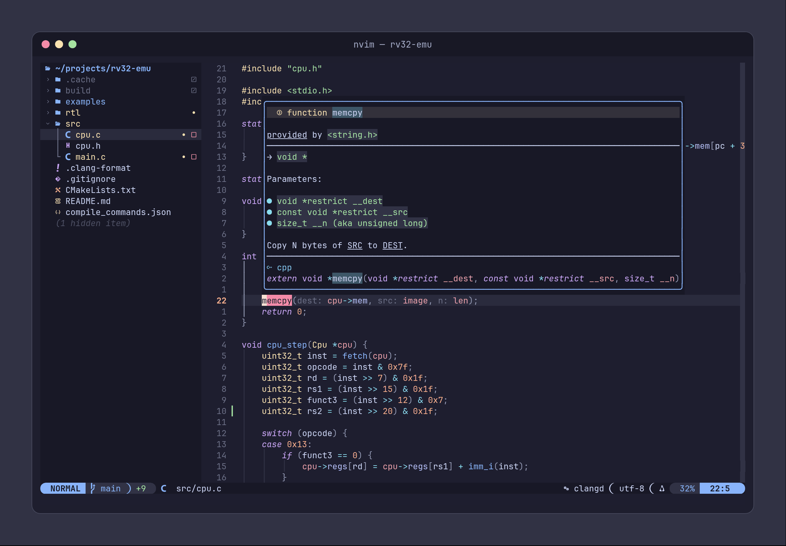</p>

## Čo to vie

- **LSP funguje hneď po prvom spustení.** Mason sám nainštaluje clangd, rust-analyzer, verible, vhdl_ls, asm-lsp a ďalšie.
- **`<Space>rr` skompiluje a spustí aktuálny súbor.** C/C++ sa kompiluje s ASan a UBSan, Rust cez `cargo run`, Verilog testbenche cez Icarus spolu so všetkými `.sv`/`.v` súbormi v priečinku (alebo podľa `verible.filelist`).
- **Debugger.** codelldb a natívny GDB, vrátane remote targetu pre embedded (OpenOCD, QEMU).
- **CMake.** Configure, build, run, debug a CTest; vygeneruje aj `compile_commands.json` pre clangd.
- **HDL.** Jazykový server a formatter verible, plus verilator linter, ktorý nájde moduly aj v iných priečinkoch.
- **Formátovanie pri uložení.** Zapína a vypína sa cez `<Space>uf`.
- **Fuzzy hľadanie a grep** súborov, symbolov, skratiek a diagnostiky (snacks.nvim).
- **Git.** Lazygit, stage hunkov, blame a diffview.
- **Treesitter textové objekty a pohyb** po funkciách, triedach, argumentoch, cykloch a podmienkach.
- **which-key.** Stlač `<Space>`, počkaj a uvidíš všetky skratky.
- **Interaktívny tutor.** `:Tutor baremetal` ťa celým setupom prevedie asi za 15 minút.

## Screenshoty

| | |
|:---:|:---:|
| 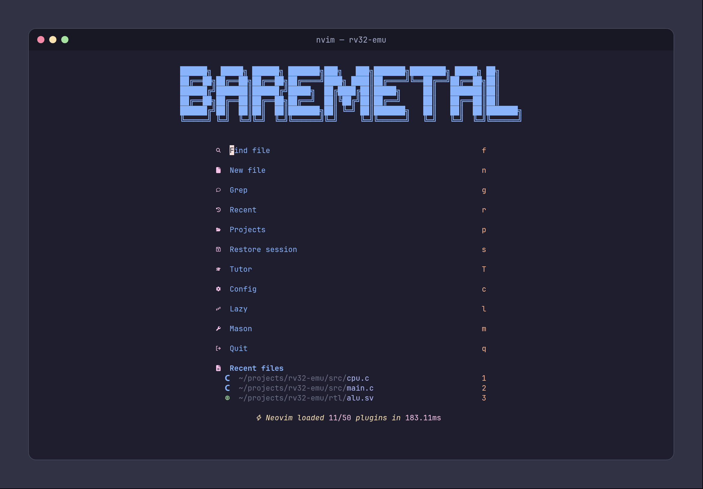<br>**Úvodná obrazovka** | 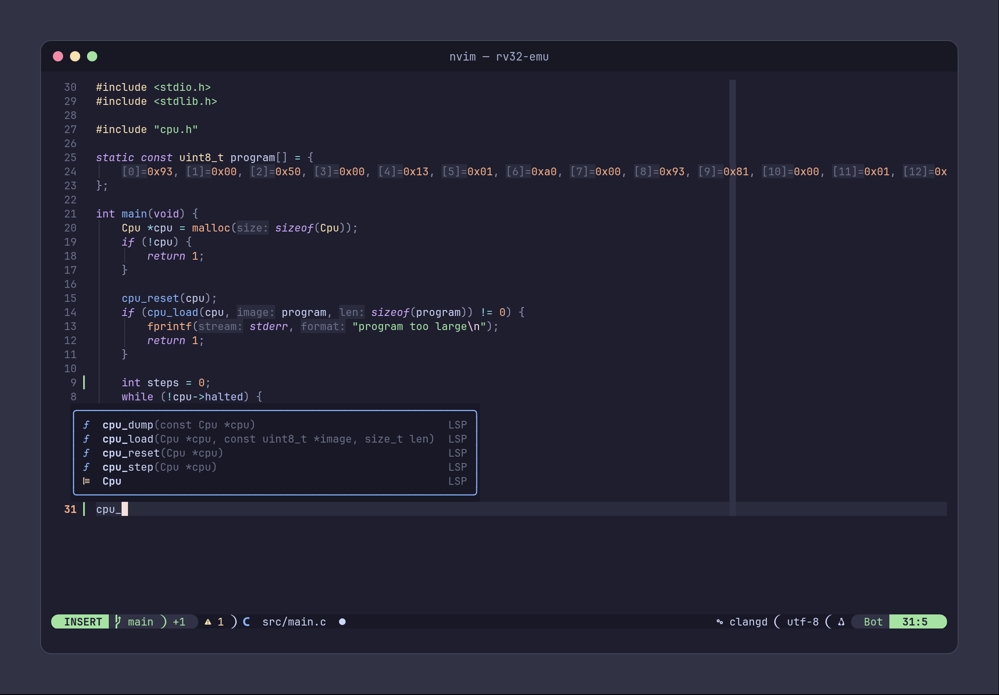<br>**Doplňovanie so signatúrami a inlay hintmi** |
| 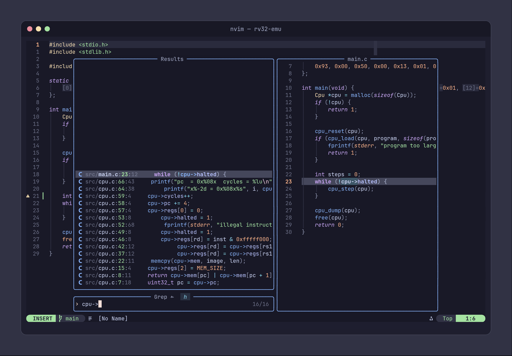<br>**Grep v projekte s náhľadom** (`<Space>/`) | 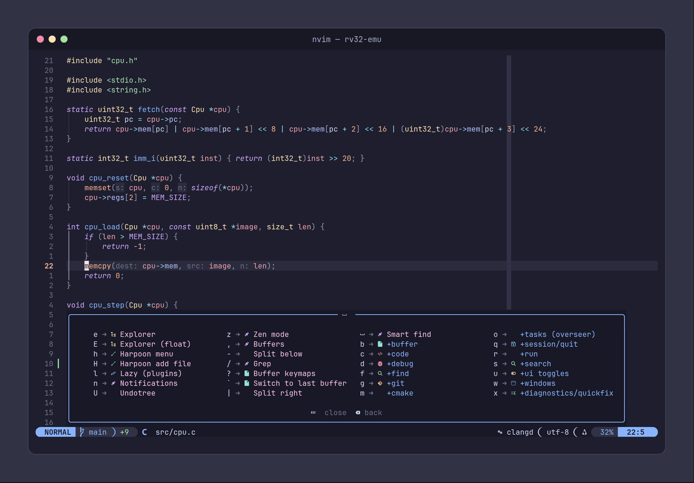<br>**which-key: stlač `<Space>` a počkaj** |
| 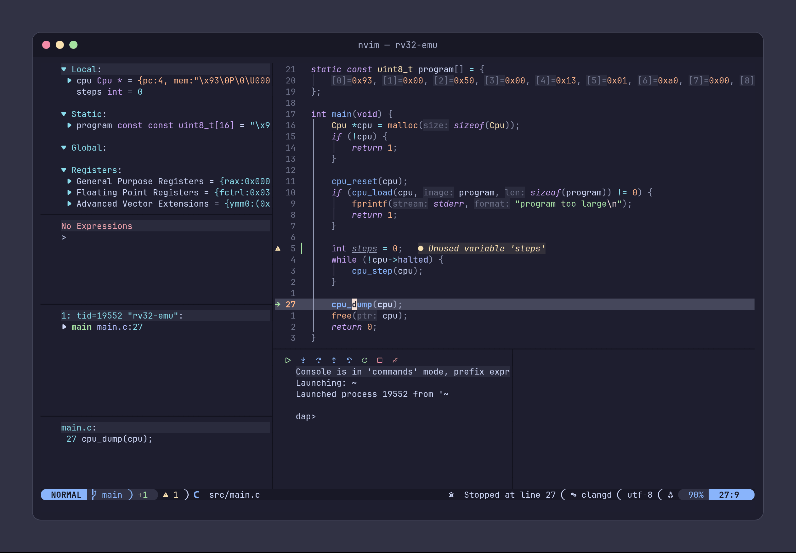<br>**Debugovanie C cez codelldb** (`F5`, `F9`, `F10`) | 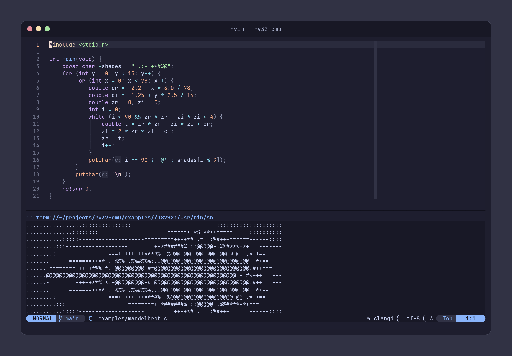<br>**Skompiluj a spusti súbor** (`<Space>rr`) |
| 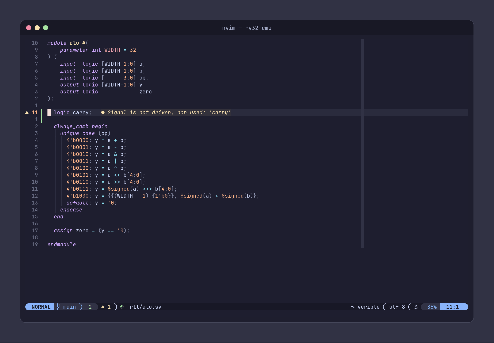<br>**SystemVerilog: verible + verilator lint** | 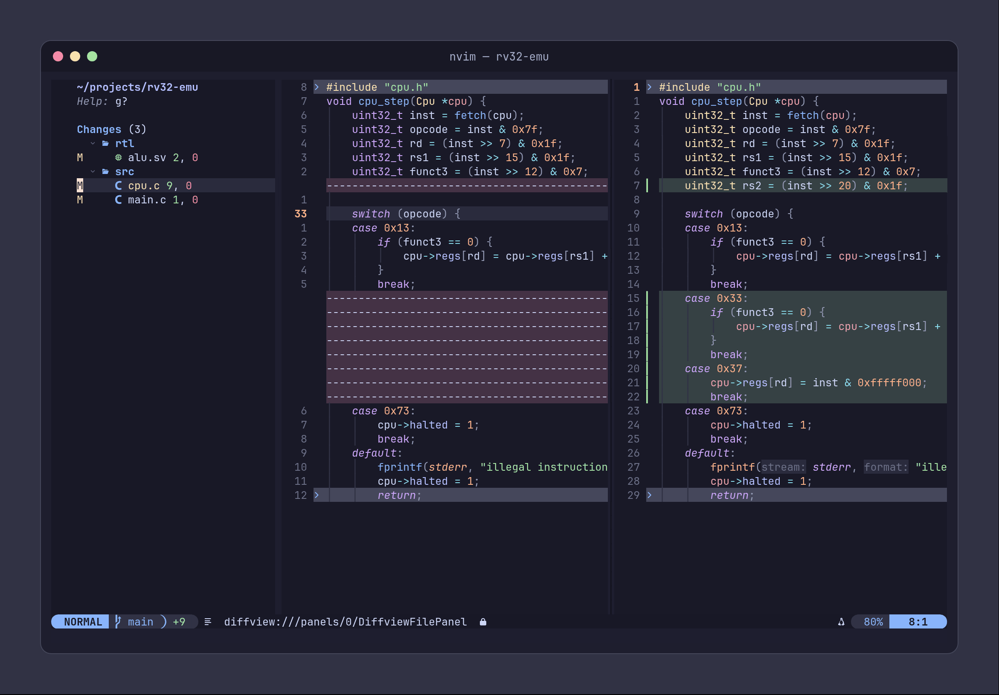<br>**Git diff** (`<Space>gd`) |
| 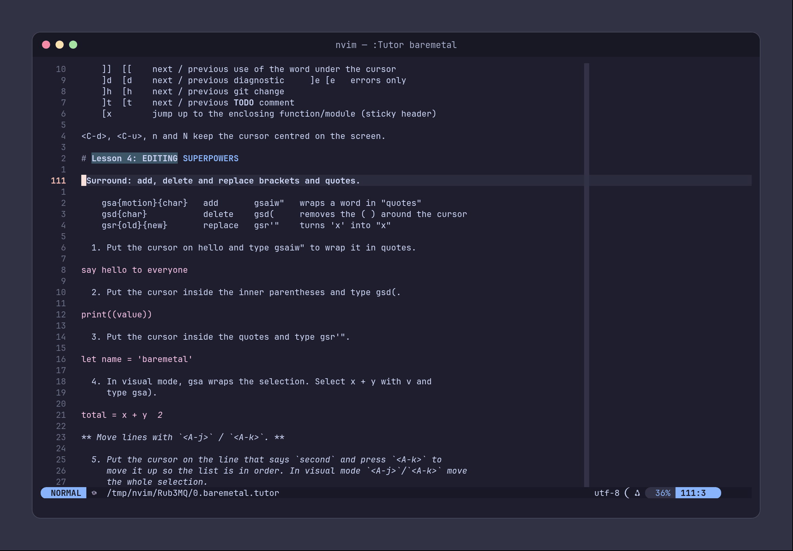<br>**Interaktívny tutor** (`:Tutor baremetal`) | |

## Postavené v baremetal.nvim

**[mnpk01-soc](https://github.com/krivanikm/mnpk01-soc)** je vlastný 16-bitový CPU / SoC v SystemVerilogu, simulovaný vo Verilatore, s cieľom bežať na FPGA Tang Nano 9K. RTL je písané v tomto setupe.

<p align="center">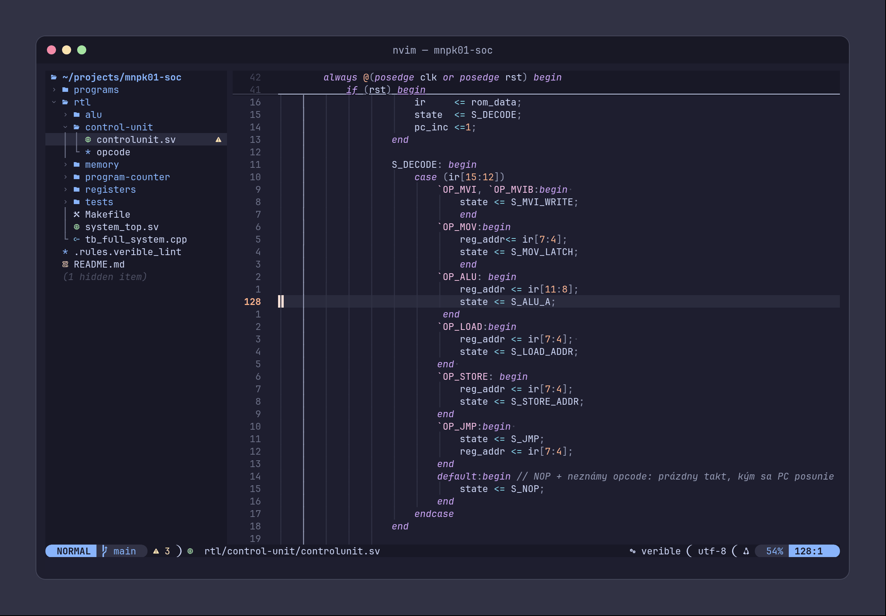</p>
<p align="center">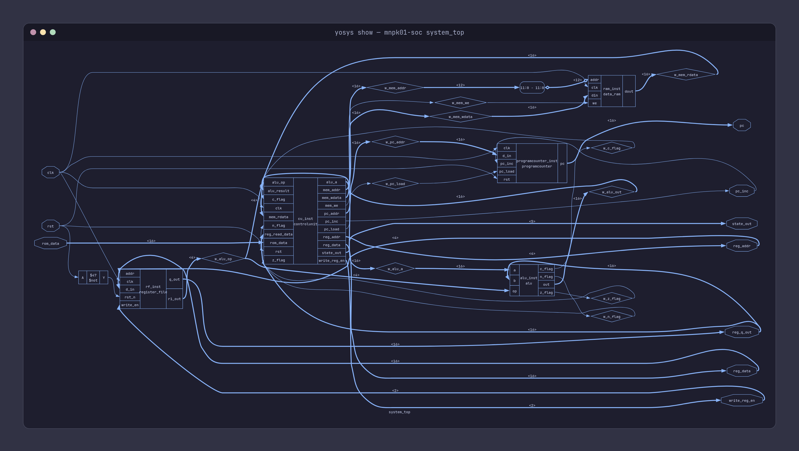</p>
<p align="center"><sub>FSM riadiacej jednotky v Neovime a netlist <code>system_top</code> vykreslený cez <code>yosys show</code>.</sub></p>

## Požiadavky

| | |
|---|---|
| Neovim | **0.11 alebo novší** |
| Nástroje | `git`, `curl`, `unzip`, `tar`, `gcc`, `make` |
| Hľadanie | `ripgrep`, `fd` |
| Mason | `node` + `npm` a `python3` (cez ne sa inštaluje viacero serverov) |
| Font | [Nerd Font](https://www.nerdfonts.com) v termináli (kitty a WezTerm majú symboly zabudované) |
| Voliteľné | `lazygit`, `bear` (compile_commands pre Make projekty), `gdb`, `cmake` |

Inštalátor ti to všetko vie doinštalovať na Arch, Debian/Ubuntu, Fedora, openSUSE a macOS (Homebrew).

## Inštalácia

```sh
curl -fsSL https://raw.githubusercontent.com/krivanikm/baremetal.nvim/main/install.sh | bash
```

Inštalátor spraví tieto kroky:

1. Opýta sa ťa, ktoré jazyky chceš (menu so zaškrtávaním).
2. Po potvrdení doinštaluje systémové balíky, ktoré tie jazyky potrebujú.
3. Zálohuje tvoj existujúci Neovim (config, data, state, cache) do `*.bak-<dátum>`.
4. Naklonuje config do `~/.config/nvim`.
5. V headless režime nainštaluje pluginy a nástroje pre vybrané jazyky.

**Z klonu** (ak to chceš upravovať): `git clone … ~/code/baremetal.nvim && ~/code/baremetal.nvim/install.sh`. Inštalátor vtedy spraví zo `~/.config/nvim` symlink na klon.

**Vyskúšať bez zmeny súčasného configu:**

```sh
curl -fsSL https://raw.githubusercontent.com/krivanikm/baremetal.nvim/main/install.sh | bash -s -- --appname baremetal
NVIM_APPNAME=baremetal nvim
```

| Prepínač | |
|---|---|
| `-l, --langs c,rust,python` | Jazyky bez menu (`all` = všetky) |
| `-y, --yes` | Bez otázok; predvolené jazyky (C/C++, Assembly, SystemVerilog), ak nie je zadané `--langs` |
| `--no-deps` | Neinštalovať systémové balíky |
| `--no-sync` | Pluginy a nástroje sa nainštalujú až pri prvom spustení |
| `--appname NAME` | Inštalácia vedľa existujúceho configu ako `NVIM_APPNAME=NAME` |
| `--repo URL` / `--branch NAME` | Inštalácia z tvojho forku alebo inej vetvy |

## Jazyky

| Kľúč | Jazyk | LSP | Formatter | Debug |
|---|---|---|---|---|
| `c` | C / C++ / CUDA + CMake | clangd | clang-format | codelldb / gdb |
| `asm` | GAS / NASM | asm-lsp | – | codelldb / gdb |
| `rust` | Rust | rust-analyzer | rustfmt | codelldb |
| `systemverilog` | SystemVerilog / Verilog | verible (+ verilator lint) | verible | sim cez iverilog |
| `vhdl` | VHDL | vhdl_ls | – | – |
| `python` | Python | basedpyright + ruff | ruff | – |
| `go` | Go | gopls | goimports | – |
| `bash` | Bash | bashls + shellcheck | shfmt | – |
| `web` | HTML / CSS / JS / TS | – | prettier | – |

Lua, JSON, YAML, TOML a Markdown sú zapnuté vždy.

Výber sa uloží do `lua/custom/languages.lua`. Git ten súbor ignoruje, takže výber nikdy nekoliduje s updatom. Keď ho neskôr zmeníš, reštartuj Neovim a spusti `:Lazy sync`.

Tipy k projektom:

- **clangd** potrebuje `compile_commands.json`. Pri CMake stlač `<Space>mg`, pri Make spusti raz `bear -- make`.
- **asm-lsp** ukazuje diagnostiku iba vtedy, keď má projekt `.asm-lsp.toml`.
- **vhdl_ls** analyzuje celý projekt, keď nájde `vhdl_ls.toml`.

## Tutor

```vim
:Tutor baremetal
```

Alebo stlač `T` na úvodnej obrazovke. Cvičíš na reálnych riadkoch, ktoré sa po správnej úprave zmenia z ✗ na ✓.

## Prispôsobenie

Vlastné zmeny patria do `lua/custom/`. Git ten priečinok ignoruje, takže `git pull` s nimi nikdy nebude v konflikte:

```
lua/custom/languages.lua    zapnuté jazyky
lua/custom/init.lua         vlastné nastavenia, skratky, autocommandy
lua/custom/plugins/*.lua    ďalšie pluginy alebo úpravy existujúcich
```

Príklady (iná téma, nový plugin, vypnutie pluginu, nový LSP server) sú v **[docs/customization.md](docs/customization.md)**.

## Update a odinštalovanie

```sh
cd ~/.config/nvim && git pull
```

Potom v Neovime spusti `:Lazy restore`, aby si mal presne tie verzie pluginov, ktoré sú v `lazy-lock.json`.

Odinštalovanie:

```sh
rm -rf ~/.config/nvim ~/.local/share/nvim ~/.local/state/nvim ~/.cache/nvim
```

Pôvodný setup vrátiš premenovaním priečinkov `*.bak-<dátum>`.

## Licencia

[MIT](LICENSE)
